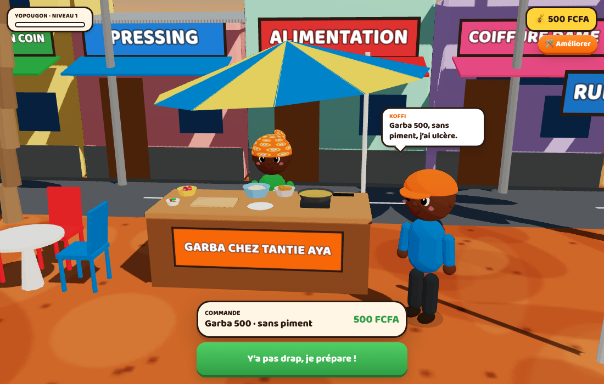
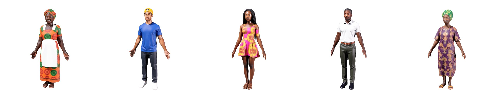
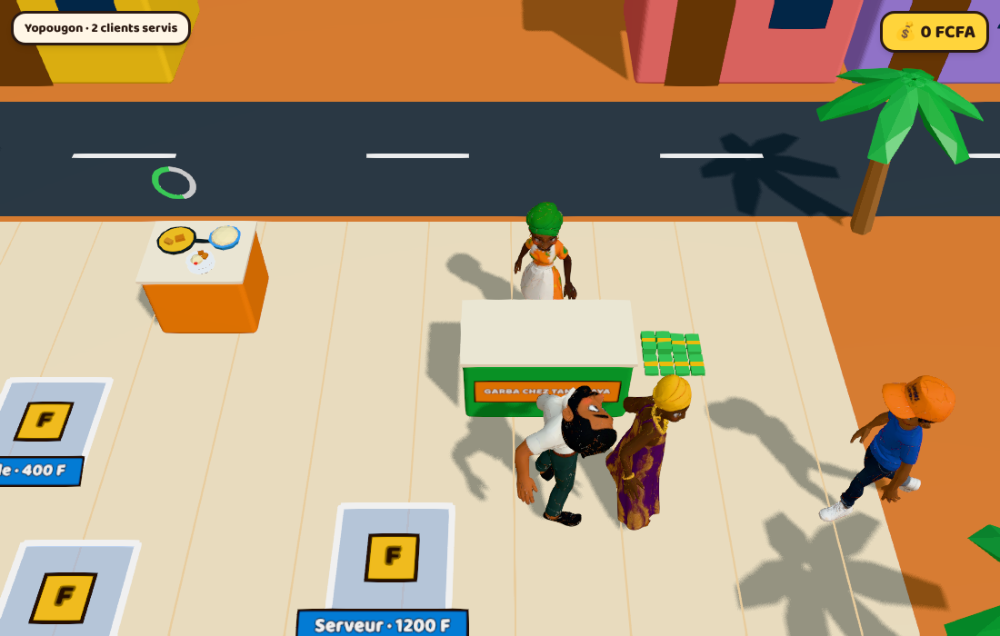
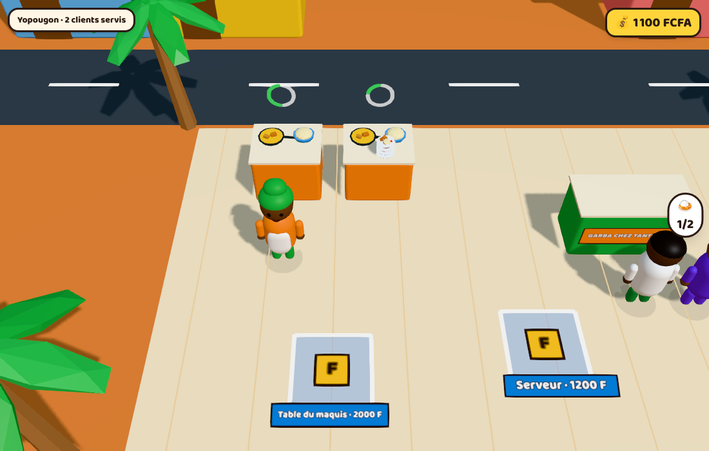
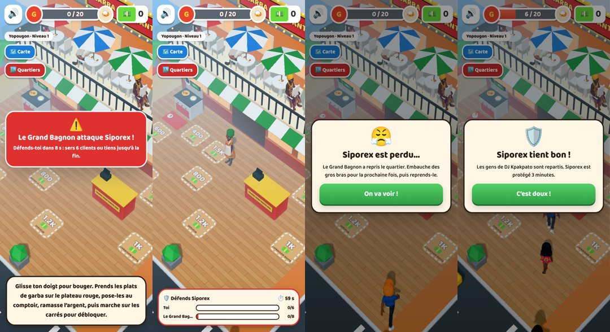
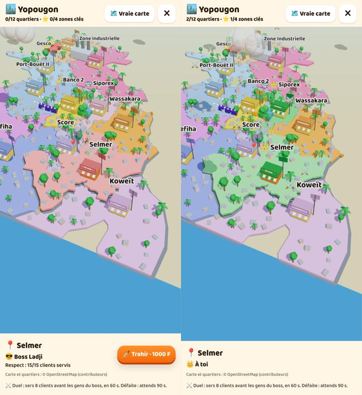

# Babiland Boss 🇨🇮

> La vision complète du jeu (le message de départ) et ce qui reste à faire : [`docs/VISION.md`](docs/VISION.md).

Un jeu de cuisine et de business à Babi. Tu pars de ton petit coin de garba à Yopougon, tu cuisines
(couper, frire, servir), tu vends, tu améliores ton matériel… et un jour tu deviens le boss de la commune.

Même chemin que Babi Life : React 19 · TypeScript · Vite · Tailwind 4 · Three.js (react-three-fiber).
Style réaliste : vrais modèles 3D scannés, textures et ciel de [Poly Haven](https://polyhaven.com) (CC0, libres
pour tout usage, voir `web/public/assets/CREDITS.md`) : latérite rouge, crépi peint, tôle rouillée, chaises
monobloc, bouteille de gaz, jerrycans, poteaux électriques… Les persos sont réalistes, faits avec Meshy (texturés, avec squelette), et bougent avec de vraies
animations en capture de mouvement : ils marchent, font la queue, parlent pour commander, se réjouissent
ou se fâchent selon le plat. Vue de dessus, comme les jeux de boutique.

| La file de clients | Couper | Les persos |
|---|---|---|
|  |  |  |

## Lancer

```bash
cd web && npm install && npm run dev
```

## Le jeu (style « arcade idle » des jeux de pub)

Vidéo de 40 s d'une partie : [`docs/demo-arcade.mp4`](docs/demo-arcade.mp4).

| Porter les plats | Servir la file | Débloquer |
|---|---|---|
|  |  |  |

- On dirige **Tantie Aya au joystick** (glisser le doigt, ou flèches / ZQSD / WASD).
- Le **poste à garba** cuit des plats tout seul ; on les ramasse en pile et on les pose sur le **comptoir**.
- Les **clients font la queue**, prennent leurs plats (🍛 1/2), paient : l'argent s'empile par terre, on marche dessus pour le ramasser.
- On marche sur les **carrés bleus** pour dépenser l’argent : 2e poêle (400 F), serveur qui porte les plats (1 200 F), terrasse (2 000 F) où les clients servis s’assoient pour manger.
- **Plat principal + plats particuliers** : chaque lieu a son plat principal et 2 plats particuliers à débloquer (Yopougon : porc au four, thé ; Cocody : poulet braisé, bissap…), chacun avec son poste ; chaque client commande un plat précis (🐟 Garba 0/3), il faut lui apporter le bon.
- **Embaucher** : serveur (puis serveur rapide), caissière (sans elle, il faut être au comptoir pour servir), livreur.
- **Livraison à moto** : des commandes arrivent par téléphone ; on charge la moto (ou le livreur le fait), elle part livrer et rapporte 700 F par plat.
- **Petits business** 🍵🍖🥤 : sur le trottoir devant chaque maquis, trois stands à ouvrir sur leur carré (vendeuse de thé au niveau 2, choukouya du soir au niveau 4, bissap au niveau 6). Chacun a sa vendeuse et vend seul aux passants ; passe devant pour ramasser l'argent (le stand affiche « PLEIN ! » quand il ne peut plus en garder). Le même carré l'améliore jusqu'au niveau 5.
- **Pendant ton absence…** 🌙 : un maquis où tu as embauché un serveur et une caissière continue de vendre sans toi (plus lentement, jusqu'à 2 h comptées) ; le livreur continue ses livraisons et tes quartiers paient leur loyer. Au retour (ou en revenant sur l'onglet), un écran montre ce que chaque maquis a gagné et ce qu'il manque aux autres.
- **Clients VIP** 👑 : de temps en temps un VIP (couronne dorée) fait la queue. Quand il arrive au comptoir, touche « Cuisiner ! » : tu prépares son plat comme dans Cooking Mama (couper en glissant le couteau sur les pointillés, frire ou griller et retourner au bon moment, monter l'assiette dans l'ordre de la recette). Selon tes étoiles il paie jusqu'à ×3, pourboire compris. S'il attend plus de 45 s, il s'en va.
- **Quartiers** (bouton 🏙️) : une **maquette 3D de la commune** (vrais contours des quartiers en relief, petites maisons, le maquis de chaque boss avec son enseigne et son drapeau, les zones clés en monuments, la lagune), et un bouton pour passer à la **vraie carte** (Mapbox) ; avec 12 vrais quartiers (Selmer, Wassakara, Siporex, Score, Banco 2, Sogefiha, Quartier Maroc, Port-Bouët II, Micao, Gesco, Zone Industrielle, Koweït) dont les contours sont calculés à partir des commerces et maquis d'OpenStreetMap. Au début tu travailles pour le boss de Selmer (il prend 20 %) ; avec 15 clients de respect et 1 000 F, tu le **trahis** (duel de 60 s). Ensuite tu attaques les quartiers qui **touchent** les tiens. **Zones clés ⭐** : Zone Industrielle +30 % de clients, Siporex (gare des gbaka) +20 % de clients, Micao (marché La Paix) postes 25 % plus rapides, Banco 2 (marché de nuit La Référence) +20 % par vente. Les quartiers conquis paient un loyer. **Tous les lieux** ont aussi leurs vrais quartiers en 3D : Cocody (Deux Plateaux, Vallon, Riviera, Angré…), Abobo (Abobo Gare, Anador, Sagbé, PK 18…), Treichville (Arras, Biafra, Belleville, Gare de Bassam, le port…), Bouaké (Commerce, Koko, Nimbo, Gonfreville…), Korhogo, Gagnoa et Man (avec ses montagnes), chacun avec ses boss et ses zones clés réelles (`tools/quarters.py` + `tools/cities.py`).
  **Les boss contre-attaquent** : toutes les 2 à 4 minutes, un boss voisin attaque un de tes quartiers (jamais ton quartier de départ). Alerte rouge, 8 s pour te préparer, puis duel de défense de 60 s : sers 6 clients ou tiens jusqu'au bout. Perdu : le quartier repart au boss. Tenu (ou tout juste conquis) : 🛡️ protégé 3 minutes. Les **gros bras** (3 niveaux, dans la fiche du quartier) ralentissent les attaquants de 20 % par niveau.

  

  **Conquête animée** : quand tu gagnes un duel, la caméra plonge sur le quartier, le drapeau du boss descend, ton vert se répand depuis le maquis, ton drapeau monte et les confettis éclatent (vidéo : [`docs/demo-conquete.mp4`](docs/demo-conquete.mp4)).
  Pour le fond Mapbox, mettre `VITE_MAPBOX_TOKEN` (le même jeton public que Babi Life) dans `web/.env.local` et sur Vercel ; sans jeton, la même carte s'affiche avec OpenFreeMap.

  
- **Carte** : achète un maquis dans les autres communes et villes (Cocody alloco, Abobo choukouya, Treichville poisson braisé, Bouaké kedjenou, Korhogo tô, Gagnoa kplala, Man sauce feuille) dès que ton niveau le permet, puis « Y aller » de l'un à l'autre. Chaque maquis garde ses postes, son équipe et sa terrasse ; l'argent te suit.
- Les persos courent ou marchent selon leur vraie vitesse, animations au bon rythme, démarrages et arrêts en douceur.
- **Améliorer chaque poste** (« Plus vite », niv 2 à 600 F, MAX à 1 500 F) : il cuit plus vite et garde plus de plats.
- Le « jus » des jeux de boutique : les plats et les billets volent en arc vers les mains, le comptoir et les clients ; les piles rebondissent ; confettis et fanfare quand on débloque ; petits sons (faits en code, rien à télécharger) et vibration sur téléphone ; bouton 🔊 pour couper le son.
- Le maquis à deux étages : enseigne lumineuse sur le toit, terrasse en haut avec des clients attablés, auvent rayé, coin de rue avec taxis et passage piéton.


- Persos cartoon style « film d’animation » (Meshy) : Tantie Aya, Koffi, Awa, Yao, Fatou ; caméra de dessus qui suit Tantie Aya. La partie est gardée sur le téléphone.


- Code : `web/src/arcade/`. La première version (mini-jeux de cuisine) reste là : `?mode=cuisine`.

## Ce qui marche (prototype)

- **Accueil** : ton nom (il s'affiche sur l'enseigne « GARBA CHEZ … »), ta commune (Yopougon ouverte, les autres « bientôt »).
- **La rue** : coin de garba sous un parasol, maquis, pressing, cabine, panneau Rue Princesse, taxi orange qui passe, cocotiers, poteaux et fils électriques.
- **Clients** : ils arrivent à pied, commandent en français avec du nouchi (garba 500 ou 1000, avec ou sans piment), réagissent selon ton plat.
- **Couper** : le couteau passe au-dessus de la tomate puis de l'oignon ; tape sur les pointillés (`web/src/game/Cut.tsx`).
- **Frire** : retourne le thon puis sors-le quand la jauge est dans le doré (`web/src/game/Fry.tsx`).
- **Servir** : monte le garba dans l'ordre : attiéké, poisson, tomate-oignon, piment si demandé (`web/src/ui/Hud.tsx`).
- **Argent et niveau** : paiement en FCFA + pourboire selon les étoiles, XP et niveaux.
- **Améliorer** : couteau aiguisé, poêle en fonte, nouvelle bâche (changent vraiment le jeu).

## La suite

1. Plus de plats et petits business (alloco, choukouya, thé…), d'autres communes et villes.
2. Maquis, restaurant, employés (vendeurs, livreurs à moto), commandes des maquis et bureaux.
3. Conquête : prendre des zones de la commune aux autres boss (d'abord contre l'ordi, puis en ligne).
4. En ligne : comptes, backend Go + Neon comme Babi Life.
