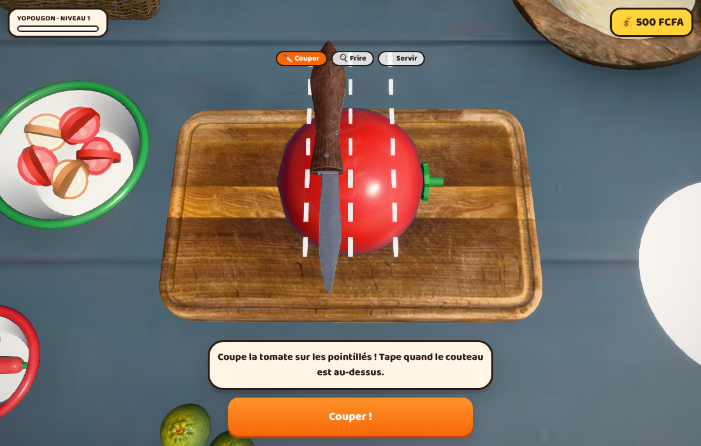
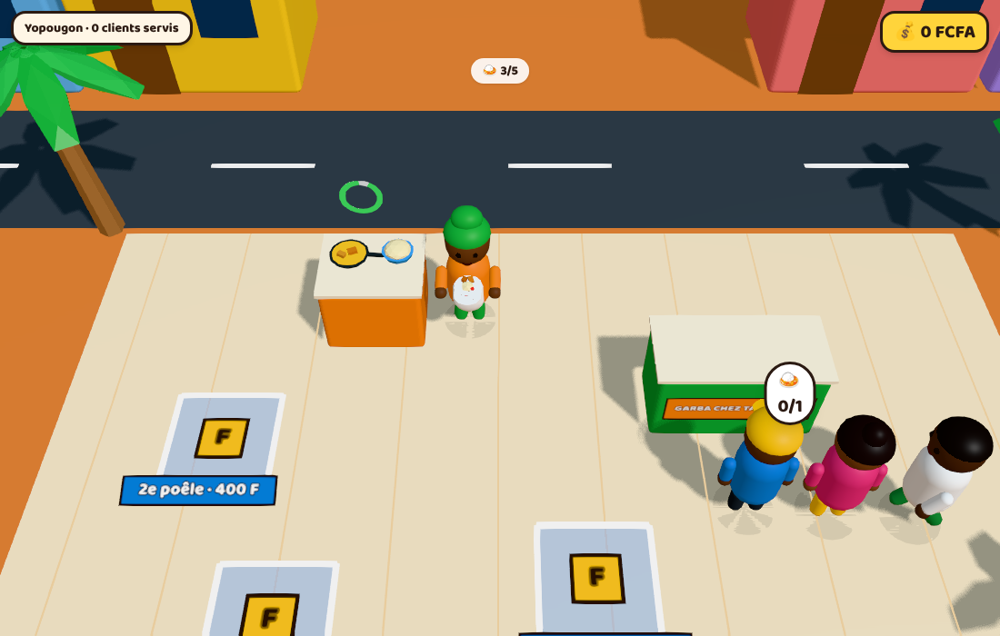
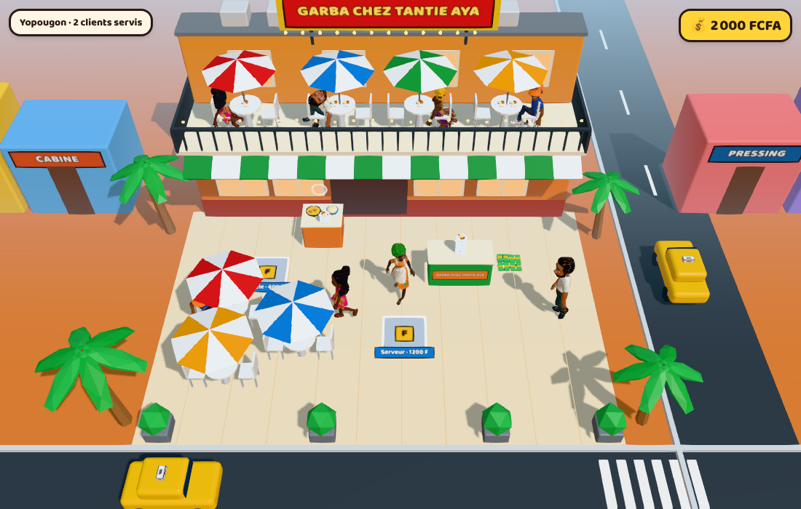
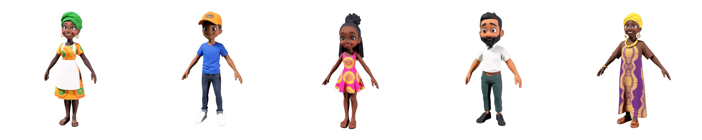

# Babiland Boss 🇨🇮

Un jeu de cuisine et de business à Babi. Tu pars de ton petit coin de garba à Yopougon, tu cuisines
(couper, frire, servir), tu vends, tu améliores ton matériel… et un jour tu deviens le boss de la commune.

Même chemin que Babi Life : React 19 · TypeScript · Vite · Tailwind 4 · Three.js (react-three-fiber).
Style réaliste : vrais modèles 3D scannés, textures et ciel de [Poly Haven](https://polyhaven.com) (CC0, libres
pour tout usage, voir `web/public/assets/CREDITS.md`) : latérite rouge, crépi peint, tôle rouillée, chaises
monobloc, bouteille de gaz, jerrycans, poteaux électriques… Les persos sont réalistes, faits avec Meshy (texturés, avec squelette), et bougent avec de vraies
animations en capture de mouvement : ils marchent, font la queue, parlent pour commander, se réjouissent
ou se fâchent selon le plat. Vue de dessus, comme les jeux de boutique.

| La file de clients | Couper | Les persos |
|---|---|---|
|  |  |  |

## Lancer

```bash
cd web && npm install && npm run dev
```

## Le jeu (style « arcade idle » des jeux de pub)

| Porter les plats | Servir la file | Débloquer |
|---|---|---|
|  |  |  |

- On dirige **Tantie Aya au joystick** (glisser le doigt, ou flèches / ZQSD / WASD).
- Le **poste à garba** cuit des plats tout seul ; on les ramasse en pile et on les pose sur le **comptoir**.
- Les **clients font la queue**, prennent leurs plats (🍛 1/2), paient : l'argent s'empile par terre, on marche dessus pour le ramasser.
- On marche sur les **carrés bleus** pour dépenser l’argent : 2e poêle (400 F), serveur qui porte les plats (1 200 F), terrasse (2 000 F) où les clients servis s’assoient pour manger.
- Le maquis à deux étages : enseigne lumineuse sur le toit, terrasse en haut avec des clients attablés, auvent rayé, coin de rue avec taxis et passage piéton.


- Persos cartoon style « film d’animation » (Meshy) : Tantie Aya, Koffi, Awa, Yao, Fatou ; caméra de dessus qui suit Tantie Aya. La partie est gardée sur le téléphone.


- Code : `web/src/arcade/`. La première version (mini-jeux de cuisine) reste là : `?mode=cuisine`.

## Ce qui marche (prototype)

- **Accueil** : ton nom (il s'affiche sur l'enseigne « GARBA CHEZ … »), ta commune (Yopougon ouverte, les autres « bientôt »).
- **La rue** : coin de garba sous un parasol, maquis, pressing, cabine, panneau Rue Princesse, taxi orange qui passe, cocotiers, poteaux et fils électriques.
- **Clients** : ils arrivent à pied, commandent en français avec du nouchi (garba 500 ou 1000, avec ou sans piment), réagissent selon ton plat.
- **Couper** : le couteau passe au-dessus de la tomate puis de l'oignon ; tape sur les pointillés (`web/src/game/Cut.tsx`).
- **Frire** : retourne le thon puis sors-le quand la jauge est dans le doré (`web/src/game/Fry.tsx`).
- **Servir** : monte le garba dans l'ordre : attiéké, poisson, tomate-oignon, piment si demandé (`web/src/ui/Hud.tsx`).
- **Argent et niveau** : paiement en FCFA + pourboire selon les étoiles, XP et niveaux.
- **Améliorer** : couteau aiguisé, poêle en fonte, nouvelle bâche (changent vraiment le jeu).

## La suite

1. Plus de plats et petits business (alloco, choukouya, thé…), d'autres communes et villes.
2. Maquis, restaurant, employés (vendeurs, livreurs à moto), commandes des maquis et bureaux.
3. Conquête : prendre des zones de la commune aux autres boss (d'abord contre l'ordi, puis en ligne).
4. En ligne : comptes, backend Go + Neon comme Babi Life.
