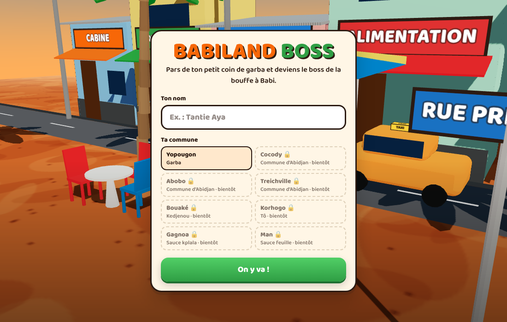
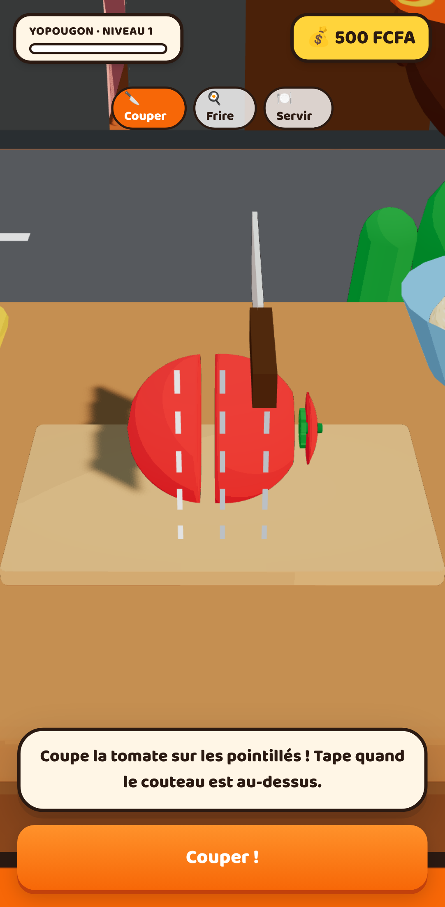

# Babiland Boss 🇨🇮

Un jeu de cuisine et de business à Babi. Tu pars de ton petit coin de garba à Yopougon, tu cuisines
(couper, frire, servir), tu vends, tu améliores ton matériel… et un jour tu deviens le boss de la commune.

Même chemin que Babi Life : React 19 · TypeScript · Vite · Tailwind 4 · Three.js (react-three-fiber).
Toute la 3D est faite en code (pas d'artiste ni de modèles à télécharger) dans un style cartoon :
ombrage « toon » en 4 paliers, contours noirs, couleurs vives.

| Accueil | Commande | Couper (téléphone) |
|---|---|---|
|  |  |  |

## Lancer

```bash
cd web && npm install && npm run dev
```

## Ce qui marche (prototype)

- **Accueil** : ton nom (il s'affiche sur l'enseigne « GARBA CHEZ … »), ta commune (Yopougon ouverte, les autres « bientôt »).
- **La rue** : coin de garba sous un parasol, maquis, pressing, cabine, panneau Rue Princesse, taxi orange qui passe, cocotiers, poteaux et fils électriques.
- **Clients** : ils arrivent à pied, commandent en français avec du nouchi (garba 500 ou 1000, avec ou sans piment), réagissent selon ton plat.
- **Couper** : le couteau passe au-dessus de la tomate puis de l'oignon ; tape sur les pointillés (`web/src/game/Cut.tsx`).
- **Frire** : retourne le thon puis sors-le quand la jauge est dans le doré (`web/src/game/Fry.tsx`).
- **Servir** : monte le garba dans l'ordre : attiéké, poisson, tomate-oignon, piment si demandé (`web/src/ui/Hud.tsx`).
- **Argent et niveau** : paiement en FCFA + pourboire selon les étoiles, XP et niveaux.
- **Améliorer** : couteau aiguisé, poêle en fonte, nouvelle bâche (changent vraiment le jeu).

## La suite

1. Plus de plats et petits business (alloco, choukouya, thé…), d'autres communes et villes.
2. Maquis, restaurant, employés (vendeurs, livreurs à moto), commandes des maquis et bureaux.
3. Conquête : prendre des zones de la commune aux autres boss (d'abord contre l'ordi, puis en ligne).
4. En ligne : comptes, backend Go + Neon comme Babi Life.
